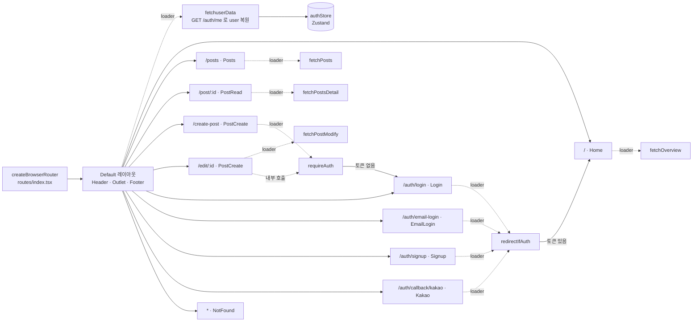
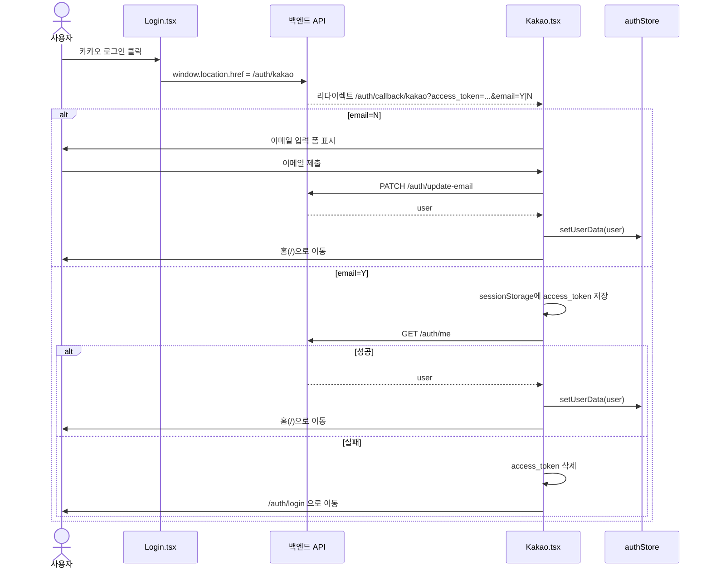
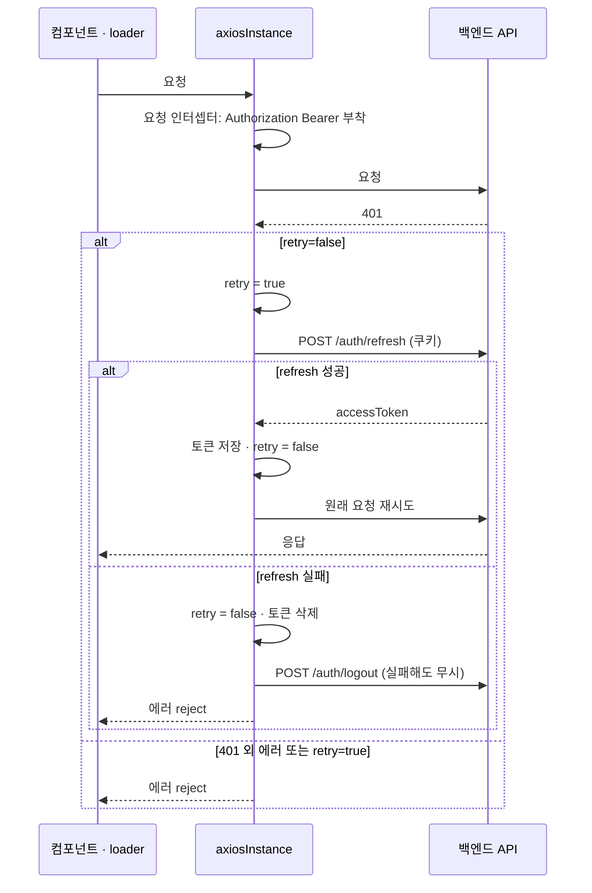
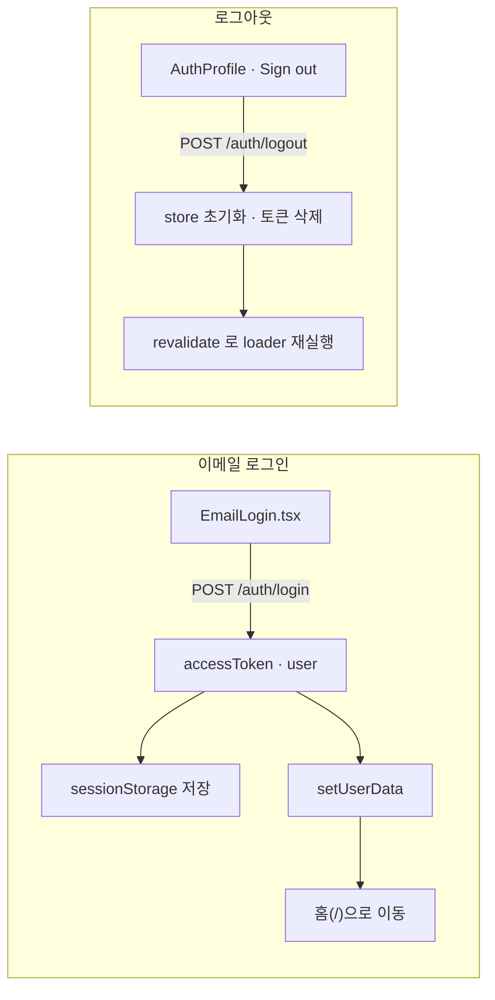
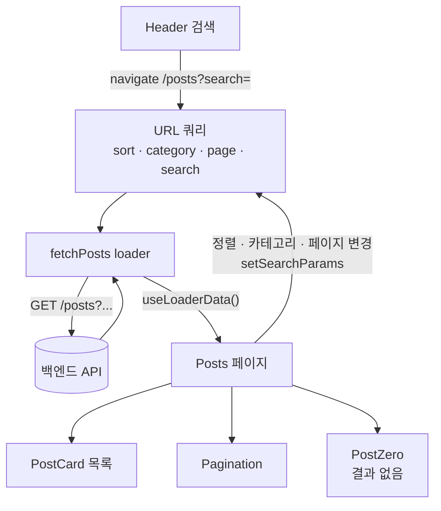
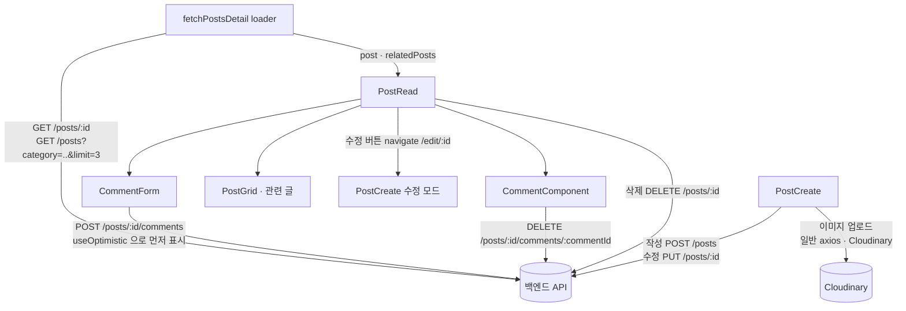
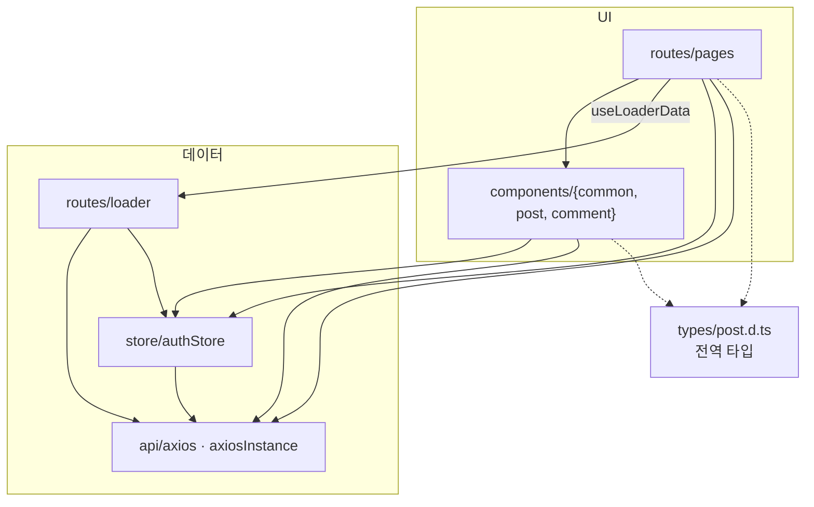

# 아키텍처 다이어그램

GitHub에서 열면 Mermaid가 자동으로 렌더링된다. VS Code에서는 Markdown Preview Mermaid Support 확장이 필요하다.
코드가 바뀌면 `CLAUDE.md`의 아키텍처 설명과 함께 갱신한다.

## 1. 라우트와 loader 구조

모든 라우트는 `Default` 레이아웃의 children이며, 레이아웃 loader가 앱 시작 시 사용자 정보를 복원한다.
가드 loader(`requireAuth`, `redirectIfAuth`)는 `sessionStorage`의 `access_token` 유무만 확인한다.

## 2. 인증 흐름

### 2-1. 카카오 로그인

### 2-2. 토큰 자동 갱신 (axios 인터셉터)

401 응답 시 한 번만 refresh를 시도한다. 중복 방지는 모듈 전역 `retry` 플래그 하나로 처리한다.

### 2-3. 이메일 로그인 / 로그아웃

## 3. 게시글 데이터 흐름

필터·정렬·페이지·검색의 원천은 URL 쿼리다. 컴포넌트는 `useLoaderData()`로 읽기만 한다.

### 게시글 상세와 쓰기 동작

## 4. 계층 구조 요약

