# 아키텍처 다이어그램

GitHub에서 열면 Mermaid가 자동으로 렌더링된다. VS Code에서는 Markdown Preview Mermaid Support 확장이 필요하다.
코드가 바뀌면 `CLAUDE.md`의 아키텍처 설명과 함께 갱신한다.

## 1. 라우트와 loader 구조

모든 라우트는 `Default` 레이아웃의 children이며, 레이아웃 loader가 앱 시작 시 사용자 정보를 복원한다.
가드 loader(`requireAuth`, `redirectIfAuth`)는 `sessionStorage`의 `access_token` 유무만 확인한다.

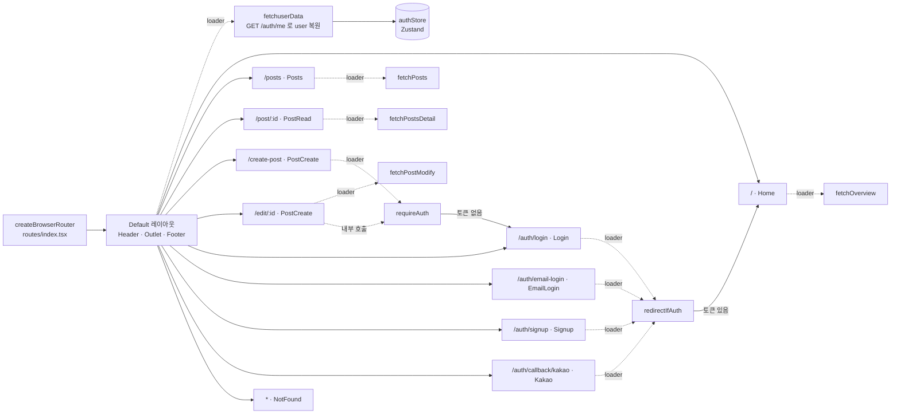

## 2. 인증 흐름

### 2-1. 카카오 로그인

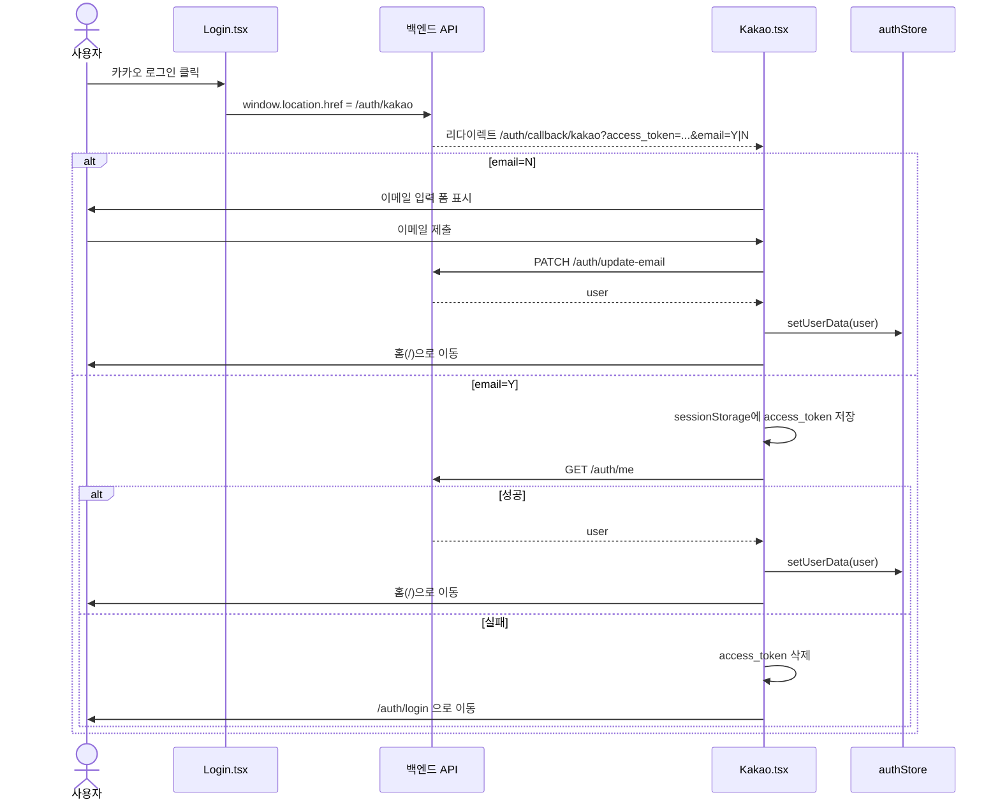

### 2-2. 토큰 자동 갱신 (axios 인터셉터)

401 응답 시 한 번만 refresh를 시도한다. 중복 방지는 모듈 전역 `retry` 플래그 하나로 처리한다.

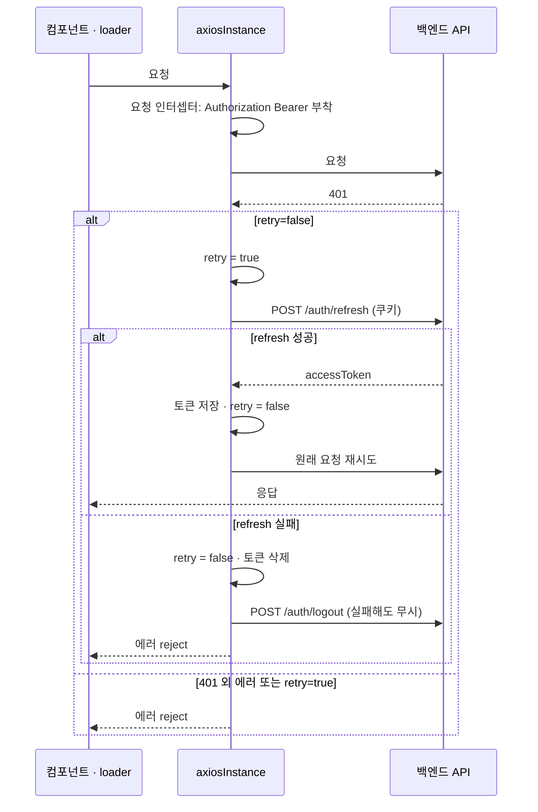

### 2-3. 이메일 로그인 / 로그아웃

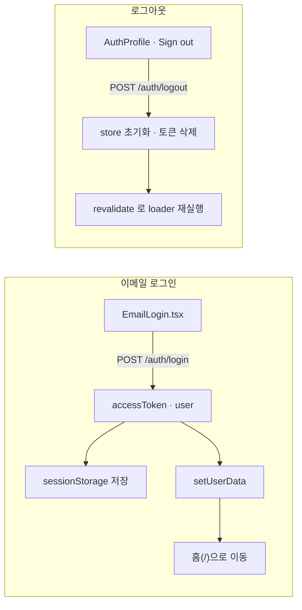

## 3. 게시글 데이터 흐름

필터·정렬·페이지·검색의 원천은 URL 쿼리다. 컴포넌트는 `useLoaderData()`로 읽기만 한다.

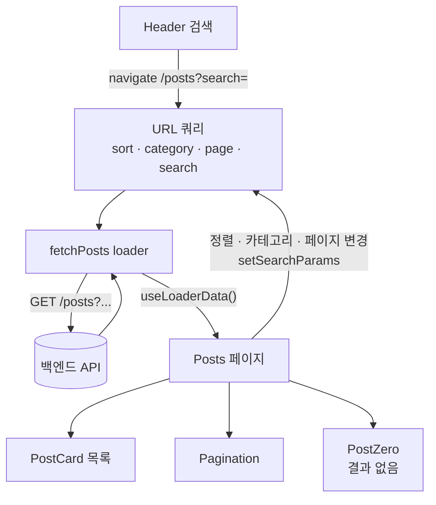

### 게시글 상세와 쓰기 동작

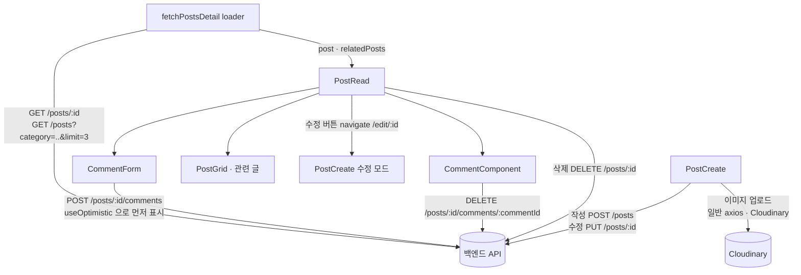

## 4. 계층 구조 요약

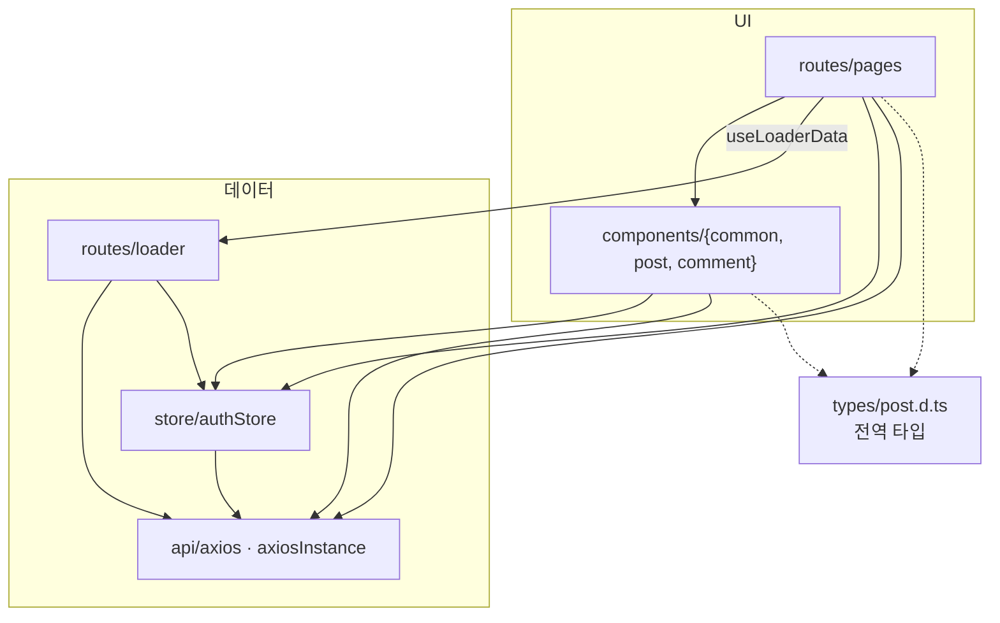

## 5. 컴포넌트 의존성

### 5-1. 컴포넌트 포함 관계 (import 기준)

화살표는 "import해서 렌더링한다"는 뜻이다. `routes/index.tsx`는 `FullLoading`(로딩)과 `ErrorState`(에러)를 라우터 옵션으로 연결한다.
`PostGrid`는 `Home`, `PostRead`에서 공유되고, `Posts`는 `PostGrid` 없이 `PostCard`를 직접 사용한다.

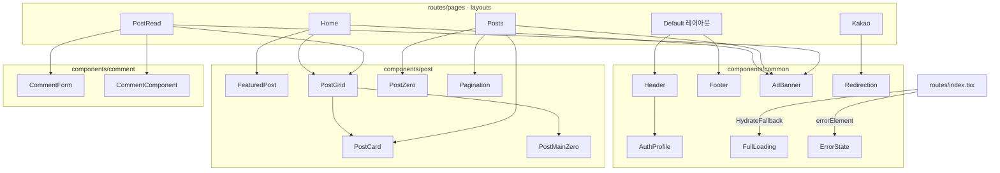

참고: `PostCardLoading` 컴포넌트는 어디에서도 import되지 않는다(미사용).

### 5-2. 컴포넌트와 데이터 계층 의존성

UI 컴포넌트가 `authStore`와 `axiosInstance`를 어디서 직접 쓰는지 보여준다. 서비스 레이어가 없어서 페이지와 컴포넌트가 `axiosInstance`를 직접 호출한다.

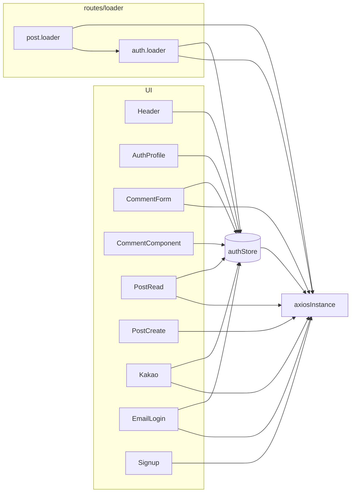

## 6. 상태 흐름

### 6-1. 상태 종류별 위치

같은 정보를 여러 곳에 중복 보관하지 않는 것이 원칙이다. 서버 데이터는 loader, 화면 조건은 URL, 로그인 정보는 `authStore`, 그 외 UI 상태는 컴포넌트 `useState`에 둔다.
예외로 `PostRead`의 `comments`와 `PostCreate`의 `formState`는 loader 값을 로컬 state로 복사해서 쓴다.

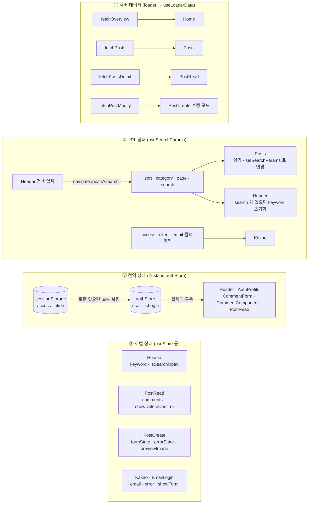

### 6-2. authStore 상태 전이

로그인 여부는 `user`가 있는지로 결정되고, 새로고침해도 `sessionStorage`의 토큰이 있으면 레이아웃 loader(`fetchuserData`)가 복원한다.

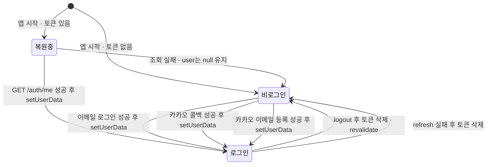

### 6-3. 댓글 상태 (로컬 state + 낙관적 업데이트)

`PostRead`가 loader의 `post.comments`를 `comments` state로 복사하고, `useOptimistic`으로 화면용 목록을 만든다. 서버 응답 전에는 임시 댓글이 보이고, 실패하면 자동으로 사라진다.

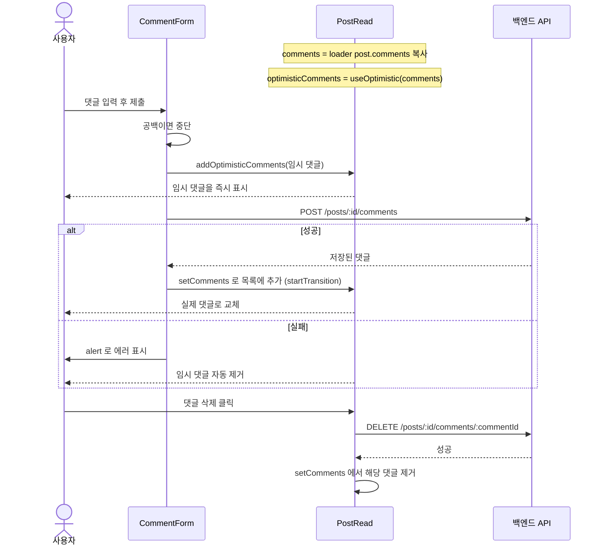

### 6-4. PostCreate 폼 상태 (작성 · 수정 공용)

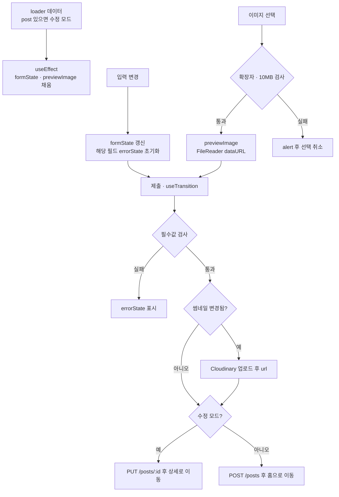
